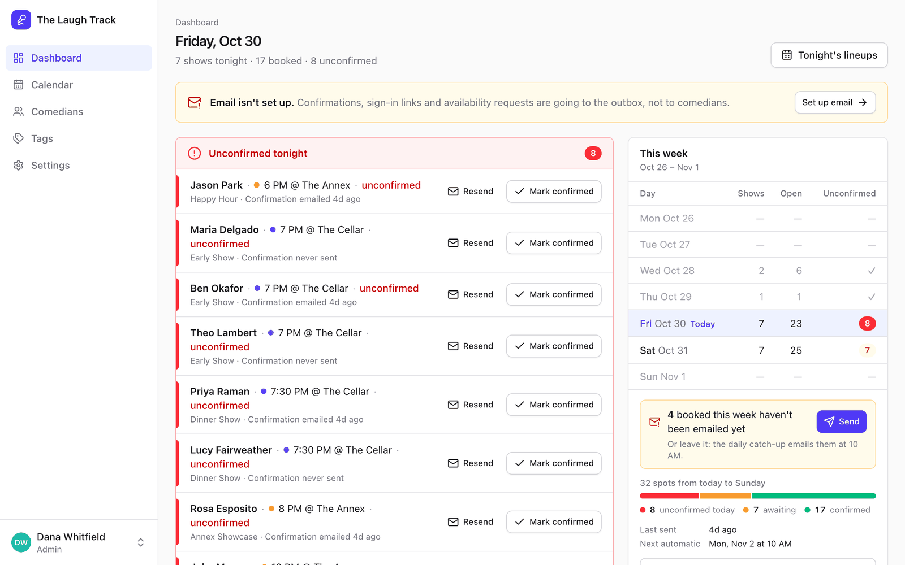
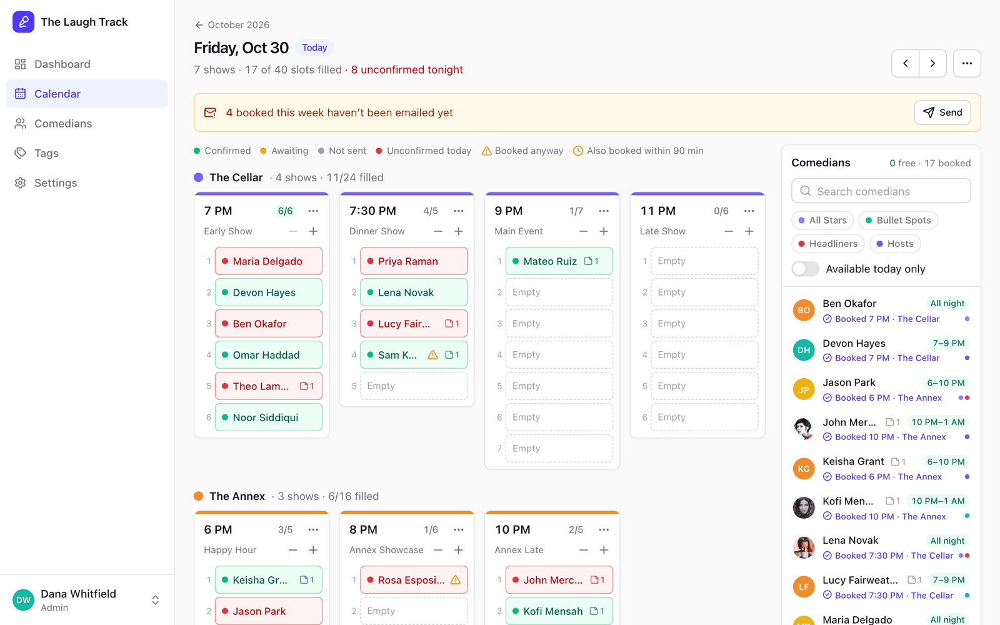
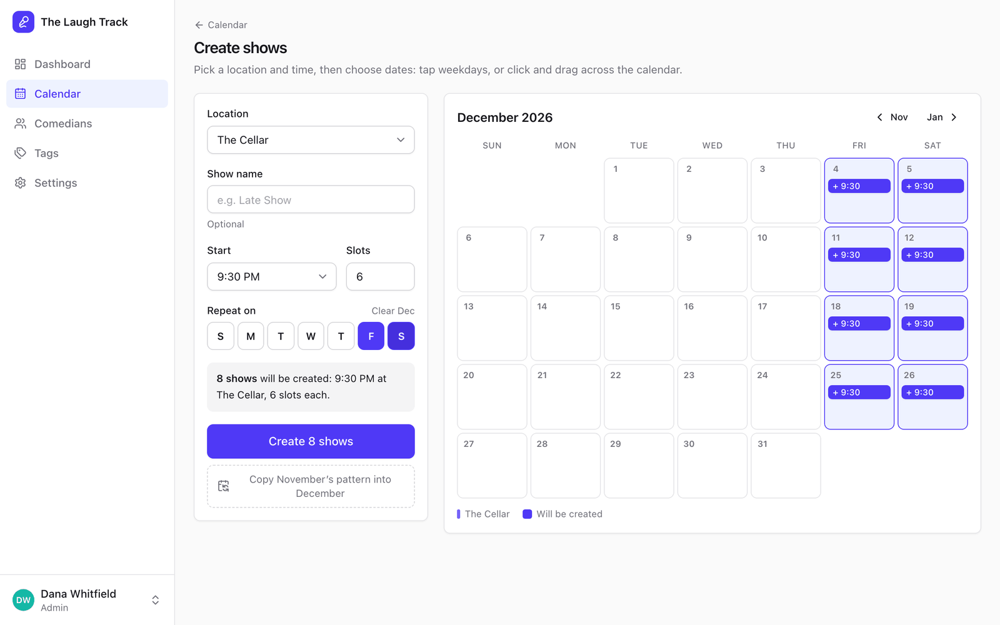
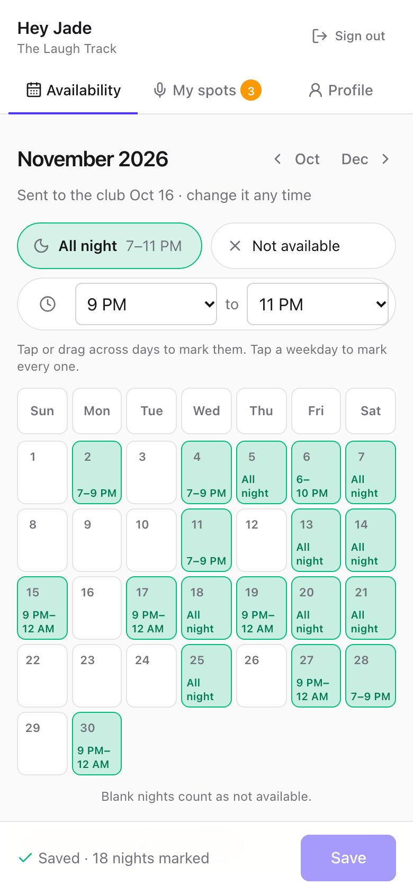

# Comedy Booking Platform

A free, open-source booking tool for comedy clubs that you host yourself. Put next month's
shows on the calendar, ask your comedians which nights they're free, build each night's
lineups by drag and drop, and let weekly confirmation emails find out who's coming. It
replaces the spreadsheet, the group chat and the "still on for Friday?" texts with one app.
Bookers get a dashboard, and comedians get a phone-friendly portal with no password to
remember. One deployment runs one club. It's a single Node process with a single SQLite
file, and a guided setup gets a new club from nothing to its first month in a few minutes.

## Features

- **Setup guide**: a new club is walked through its first month on the real screens. It
  adds a few shows, brings in the comedians and asks them for their availability. Bookers
  invited later get a short welcome tour.
- **Shows and calendar**: create a month of shows by tapping weekdays or dragging across a
  calendar, or copy last month's pattern. Several rooms, each with its own color.
- **Lineup board**: every show of the night side by side, with a pool showing who's free.
  Drag comedians into slots, swap and replace them, and undo.
- **Comedian roster**: private booker notes, tags ("Hosts", "Headliners"), an optional
  phone number, **CSV import** from your spreadsheet, and bulk add.
- **Availability requests**: one email to everyone (or to one tag) with a link straight to
  that month's calendar, plus reminders for those who haven't answered.
- **Comedian portal**: sign in with an emailed code or link, paint the nights you're free,
  and confirm your spots. Built for phones.
- **Weekly confirmations**: one email per comedian with their spots for the week, a
  one-click **Confirm**, a daily catch-up for late bookings, and optional declines.
- **Dashboard**: who's unconfirmed tonight, spots that need a replacement, the week ahead,
  and availability progress.
- **Works before email does**: until you connect an SMTP provider, every email waits in an
  in-app outbox where you can read it, so you can try everything first.
- **Easy to run**: Docker, automatic migrations, one-click backups, admin and booker roles,
  sensible security defaults.

## Screenshots

**Dashboard**: tonight at a glance, the week ahead, and who has sent their availability.



**Lineup board**: every show that night; drag comedians from the pool into the slots.



<table>
  <tr>
    <td width="66%" valign="top">
      <strong>Create shows</strong>: tap a weekday to fill the month, then create them all at once.<br><br>
      
    </td>
    <td width="34%" valign="top">
      <strong>Comedian portal</strong>: comedians mark their nights on their phone.<br><br>
      
    </td>
  </tr>
</table>

## Quick start

### With Docker

```sh
git clone https://github.com/Desitrain22/Comedy-Booking-Platform.git
cd Comedy-Booking-Platform
docker compose up -d
```

Open <http://localhost:3000>. The first visit runs a short setup wizard (club name and
timezone, your first location, your admin login), and then the [setup
guide](#your-first-month-the-setup-guide) takes over. The address you run the wizard from is
saved as the base URL for links in emails. You can change it later in Settings → Club.

Data lives in the `club-data` volume (`/data/club.db` in the container). Migrations run
automatically on start, so upgrading is:

```sh
git pull && docker compose up -d --build
```

Without Compose:

```sh
docker build -t comedy-booking .
docker run -d -p 127.0.0.1:3000:3000 -v comedy-data:/data --name comedy-booking comedy-booking
```

### Without Docker

You need Node 24 or newer, and npm.

```sh
git clone https://github.com/Desitrain22/Comedy-Booking-Platform.git
cd Comedy-Booking-Platform
npm install
npm run dev      # API on :3000 + Vite on :5173 → open http://localhost:5173
```

For a production build without Docker: `npm run build && npm start` (one process on
`PORT`, serving the app and the API).

### Try it with demo data

The seed script **wipes the database** and fills it with a demo club, "The Laugh Track":
two rooms, 30 comedians, shows this month and next, and bookings for this week and next,
including some unconfirmed spots tonight. Everything is relative to today, so the dashboard
always has something to show.

```sh
npm run seed                                   # local: ./.data/club.db
docker compose exec app node dist/server/seed.js   # Docker
```

| Who | Sign in at | Credentials |
|---|---|---|
| Admin | `/login` | `admin@example.com` / `comedy123` |
| Booker | `/login` | `booker@example.com` / `comedy123` |
| Comedians | `/portal/login` | first name @example.com: `john@example.com`, `jason@example.com`, `maria@example.com`, … |

Comedians sign in with a code. With no email set up, read it from the outbox (Settings →
Email → Email log, as the admin) or the server log (`docker compose logs app`).

## Your first month: the setup guide

The setup wizard is step 1 of 3 of the **setup guide**. The guide then walks the new admin
through the real screens one thing at a time. The rest of the page dims, the button to use
next is lit, and a small card says what to do:

1. **Club**: the wizard (club, first location, admin login).
2. **Shows**: on Create shows for the month you're planning, pick a room and a start time,
   tap a weekday (F puts the show on every Friday) and create. The step is done once 3
   shows are on the calendar.
3. **Comedians**: import your roster from a CSV or add comedians one at a time, then send
   the availability request for the month with the shows. If email isn't connected yet, the
   card offers **Connect email**, or **Send anyway** to leave the requests in the outbox
   until you connect it.

The guide waits for the real thing: it moves on when the shows exist, not when a button is
clicked. After a reload, or the next time you sign in, it picks up where you left off. **Esc**
shrinks it to a small "Resume" pill. **Skip guide** puts it away, and **Setup guide** in the
user menu (bottom left) or **Resume setup guide** on the dashboard's Getting started card
brings it back. It ends with "You're set up" and never starts on its own again. On phones the
card sits at the bottom of the screen.

Bookers you invite later get a **welcome tour** instead: four quick stops (Dashboard,
Calendar, Comedians, Settings), shown once. Replay it any time from the user menu
(**Welcome tour**).

## Importing comedians from a CSV

**Comedians → Import CSV** takes the roster you already keep. Export it as CSV from Excel,
Google Sheets or Numbers, then choose or drop the file:

| Column | | Also recognized as |
|---|---|---|
| **Name** | required | Full name, Comedian, Comic, Performer, Stage name, or separate **First name** + **Last name** columns |
| **Email** | required | E-mail, Email address, Mail |
| **Phone** | optional | Phone number, Cell, Mobile, Tel, Telephone |
| **Notes** | optional | Note, Comments, Remarks |

- **Download a template** in the dialog gives you `comedians-template.csv`: the four
  headers and one example row.
- Headers are matched loosely (case and spacing don't matter). Other columns are listed as
  ignored, and a file with no header row is read as Name, Email, Phone, Notes. Comma,
  semicolon and tab-separated files work, including quoted fields with commas or line breaks.
- You see every row and its status before anything is saved: **New**, **Already on
  roster**, **Duplicate in file**, **Invalid email**, **Needs an email**, **Needs a name** or
  **Invalid phone**. Only new rows are imported. Duplicates and comedians already on the
  roster (same email, in any case) are skipped, never overwritten.
- **Notes** become a private booker note on the new comedian, written by you, the same as a
  note added by hand. Comedians never see them.
- **Phone** is optional and kept as typed: digits, spaces, `+ ( ) - .` and an extension
  (`ext` or `x`), up to 40 characters. Bookers see it on the roster, the profile and the
  hover card, and comedians can edit their own on the portal's Profile tab. It's never used
  to send texts.
- Each new comedian is emailed a sign-in link unless you untick **Email each new comedian a
  sign-in link**.
- Up to 1,000 rows and 2 MB per file. **Bulk add** (paste a list) reads the same four columns.

## How it works

The app is built around a club's monthly rhythm:

1. **Create next month's shows.** Pick a room, time and slot count, then tap weekday
   chips or drag across the calendar, or copy last month's pattern in one click.
2. **Ask for availability.** From the dashboard, send an availability request to everyone
   or to one tag (say, "Hosts"). Each email has a sign-in link straight to that month.
3. **Comedians mark their nights.** They paint the nights they're free on a month
   calendar ("All night" or a range like 9–11 PM) and press Save.
4. **Build lineups.** Open a night on the day board: every show across your rooms, with
   the comedian pool beside it showing who's free. Drag comedians into slots. Booking
   someone who isn't available asks first ("Book anyway?").
5. **Confirmations go out weekly.** On the day and time you choose (Monday 10 AM by
   default), every comedian with an unconfirmed spot that week gets one email listing their
   spots and a **Confirm my spots** button. Spots booked after that go out in a **daily
   catch-up** at the same time of day.
6. **Comedians confirm with one click.** Opening the link only shows the spots; the button
   confirms them (so email scanners can't confirm by accident). If you allow it, they can
   also say **Can't make it** for a single spot.
7. **Tonight at a glance.** The dashboard lists, in red, anyone still unconfirmed for
   tonight, with **Resend** and **Mark confirmed** buttons, and any declined spot under
   **Needs a replacement**. "Tonight" lasts until 6 AM, so a 1 AM show stays on it.

### Confirmations, late bookings and declines

- **Weekly send.** Settings → Confirmations sets the day and time. One email per comedian
  lists all their spots that week that haven't started yet. If the server was down at send
  time, the send goes out as soon as it's back, as long as that week isn't over. Changing the
  schedule (or turning it on) mid-week can make a send due right away; the Confirmations tab
  says so before you save.
- **Daily catch-up** (`Email late bookings daily`, on by default). Every day at the
  confirmation time, comedians with a spot this week that was booked after the weekly email
  (scheduled, unconfirmed, not declined, never emailed) get their week's email. Until then
  the dashboard and the day board show **"N booked this week haven't been emailed yet –
  Send"** to send them now. Nobody is emailed twice about the same spot.
- **Declines** (`Let comedians decline individual spots`, off by default). Off, confirming
  is all-or-nothing for the week, and a comedian who can't make a spot replies to the email
  (Reply-To falls back to the first admin's address when none is set). On, each spot in the
  email and the portal gets **Can't make it?** with an optional note. The emailed link only
  opens the form; declining is a separate click. A declined spot stays in its slot, struck
  through and marked **Declined — Replace**, and is listed on the dashboard under **Needs a
  replacement**. Pick a comedian from the pool (or drop one from another show) onto it to
  replace it; **Undo** brings the decline back. Declined spots are never emailed or counted
  as unconfirmed, and "confirm my spots" never confirms them. With declines off there is no
  decline UI anywhere; a spot declined while they were on still shows as Declined until you
  replace it.

### Screens in detail

**Booker app** (`/app`, left nav: Dashboard · Calendar · Comedians · Tags · Settings; the
user menu at the bottom has Setup guide or Welcome tour, the comedian portal, and Sign out)

- **Dashboard**: for a new club, the **Getting started** card (the guide's three steps
  with progress, plus connecting email and inviting another booker, and **Resume setup
  guide**). Then unconfirmed tonight (red, with **Mark confirmed** and its Undo), **Needs a
  replacement** (declined spots), tonight's shows with their lineups, this week day by day
  with the catch-up nudge and **Send confirmations now**, and availability progress for this
  month, the month you're planning (next month from the 20th) and the one after, with
  **Request availability** (it shows when you last asked and defaults to a reminder for
  those who haven't answered).
- **Calendar** (`/app/calendar`): the month's shows as colored pills per room
  (`7:30 · Cellar · 5/7`), filterable by location. Click a day for its day board, click a
  pill to edit, cancel or delete the show. The editor can apply a change to every show at
  the same room, weekday and time that month, and warns when a new time no longer suits a
  booked comedian.
- **Create shows** (`/app/shows/new`): room, optional name, start time and slots; choose
  dates with weekday chips or by click-dragging the calendar, with a live summary.
  Duplicates are skipped. "Copy last month's pattern" previews before it creates. Both
  offer **Undo** in their success message.
- **Day board** (`/app/day/:date`): every show that night, grouped by room, with numbered
  slots and status colors (confirmed / awaiting / not sent / unconfirmed today). The pool
  on the right has search, tag filters and "available only". Drag from the pool to book;
  drop on an occupied slot to replace that comedian (they go back to the pool). Drag a
  booked comedian to move them, or onto another to swap. Drag back to the pool or click ×
  to remove. Removing and replacing both offer **Undo**, which restores the booking
  exactly, confirmation included. Click-to-select then click a slot works too (keyboard
  and touch). Every change saves immediately. Select an empty slot (or "Who's free at
  9 PM" in a show's menu) and the pool shows how each comedian fits that time and who is
  already booked within 90 minutes. A note icon on chips and pool cards opens the
  comedian's notes. The menu has **Cancel all shows this day** (with Undo).
- **Comedians** (`/app/comedians`): the roster (name, email, phone, tags) with search
  (name, email or phone), tag filter, archived toggle, bulk tag/archive/**Send sign-in
  link**, **Add comedian**, **Import CSV** and **Bulk add** (paste `Name, email` lines,
  optionally with phone and notes). Adding emails new comedians a sign-in link unless you
  untick it. Each **profile** has tags, private notes, phone, a read-only availability
  calendar, upcoming spots, **Send sign-in link**, edit and archive. Hover a name anywhere
  to see tags and notes.
- **Tags** (`/app/tags`): groups like "Hosts" or "Headliners": create, rename, recolor,
  delete. Click one to see its comedians.
- **Settings** (`/app/settings/<tab>`): **Club** (name, timezone, app address, the
  "All night" range), **Locations**, **Email** (provider, test email, and the email log),
  **Confirmations** (on/off, day and time, the daily catch-up, declines) and **Account**
  (change your password). Admins also get **Bookers** (invite, roles, remove) and
  **Backup**. The **email log** is admin-only, because it contains comedians'
  sign-in codes and links; other bookers see "Only admins can view the email log".

**Comedian portal** (`/portal`, tabs: Availability · My spots · Profile)

- **Availability**: pick a brush (**All night**, a custom range, or **Not available**),
  then tap or drag across days, or tap a weekday to mark every one. Nothing is saved until
  **Save**. If there are unsaved changes, following a link, pressing Back or Forward, or
  switching months asks you to Save, keep editing or discard. Closing the tab gets the
  browser's "Leave site?" prompt. **Undo** and **Discard** sit next to Save.
- **My spots**: upcoming spots by week, with **Confirm these spots** (and **Can't make
  it?** per spot when the club allows declines). The tab shows how many are left to
  confirm. Spots after midnight say so: "1 AM (early Sat, Nov 7)".
- **Profile**: name, bio, headshot link and phone (optional). Email is read-only.
- **Sign-in links** (`/portal/magic/:token`, from availability requests and "Send sign-in
  link") sign in without a code and are valid for 30 days. **Confirm links**
  (`/portal/confirm/:token`, from the weekly email) work without signing in and expire two
  days after that week ends. Confirming from one signs the comedian in for 7 days (a code
  gives 90).

## Configuration

Club settings (name, timezone, app address, locations, email, confirmation schedule) live
in the app under **Settings**. The environment only covers infrastructure, plus fallbacks.
Set variables in the environment or in a `.env` file (see [`.env.example`](.env.example));
real environment variables win.

| Variable | Default | Purpose |
|---|---|---|
| `PORT` | `3000` | API port (and the whole app in production) |
| `VITE_PORT` | `5173` | Vite dev server port (`npm run dev` only) |
| `DATA_DIR` | `./.data` | Folder holding `club.db` (`/data` in Docker) |
| `APP_URL` | (none) | Base URL for email links when Settings → Club has none |
| `TRUST_PROXY` | (none) | Number of reverse proxies in front of the app (usually `1`). See [Security](#security) |
| `BCRYPT_ROUNDS` | `10` | Password hashing cost for booker accounts |
| `SMTP_HOST`, `SMTP_PORT`, `SMTP_SECURE`, `SMTP_USER`, `SMTP_PASS`, `SMTP_FROM_EMAIL`, `SMTP_FROM_NAME`, `SMTP_REPLY_TO` | (none) | Fallback SMTP settings, used only when Settings → Email has no host |

### Email

The app sends sign-in codes, sign-in links, availability requests and reminders, weekly
confirmations and booker invites. Configure it in **Settings → Email**, then press
**Send test email**. Any SMTP provider works; the app has presets for these:

- **Gmail / Google Workspace**: turn on 2-Step Verification, create an App Password at
  <https://myaccount.google.com/apppasswords>, and use host `smtp.gmail.com`, port `465`,
  secure on, your full address as the username and the 16-letter app password. Gmail sends
  roughly 500 emails a day (2,000 with Workspace), which is plenty for most clubs.
- **Resend**: verify your domain at <https://resend.com>, create an API key, and use host
  `smtp.resend.com`, port `465`, username `resend`, password = the API key. The From
  address must be on your verified domain.
- **Postmark**: use your Server API token as both username and password.
- **Custom**: any server name, port (usually 465 or 587), username and password.

If a send fails, the test shows the server's error with a plain-language hint. SMTP
connections time out after 10 seconds (20 seconds of silence once connected), so a wrong
host can't stall the weekly confirmation run.

Until email is set up, every message is stored in the **outbox** instead: an admin can read
it in **Settings → Email → Email log** (and copy a sign-in code or link by hand), and it's
also printed in the server log. Invite links are shown on screen too
when you invite a booker.

Weekly confirmation emails go out on the day and time set in **Settings → Confirmations**
(Monday 10 AM club time by default). Each covers the Monday-to-Sunday week starting on or
after that day and goes only to comedians with an unconfirmed spot who haven't been emailed
for that week yet; the automatic send runs once per week. **Send confirmations now** on the
dashboard sends the current week straight away (you can limit it to comedians who haven't
been emailed yet).

## Deploying

The app is a single container. It needs:

- a persistent volume mounted at `/data` (the SQLite file lives there);
- port `3000` (or set `PORT`);
- HTTPS in front of it. Session cookies are `Secure` (and `__Host-` prefixed) when the app
  URL starts with `https://`. Your proxy must pass the original `Host` header (Caddy does by
  default; for nginx add `proxy_set_header Host $host;`);
- `TRUST_PROXY=1` when that proxy (or a platform router, as on Railway, Render and Fly) sits in
  front, so sign-in rate limits see each visitor's own IP. See [Security](#security).

Run the setup wizard from your real public URL, or set it later in Settings → Club (or with
`APP_URL`), so links in emails point to the right place. Run **one** instance only: SQLite
and the scheduler are single-node by design. The container has a health check on
`/api/health`.

- **Railway:** create a service from this repo (it builds the Dockerfile), add a volume
  mounted at `/data`, and generate a domain.
- **Render:** create a Web Service from the repo with the Docker runtime, add a persistent
  disk mounted at `/data` (this needs a paid instance), and set the health check path to
  `/api/health`.
- **Fly.io:** run `fly launch` (it detects the Dockerfile), then
  `fly volumes create data --size 1`, and add `[mounts] source = "data"`,
  `destination = "/data"` to `fly.toml`. Keep one machine.
- **Any VPS:** install Docker and run `docker compose up -d`. Compose publishes the port on
  `127.0.0.1` only, so put Caddy or nginx in front for TLS and set `TRUST_PROXY=1`. With Caddy:
  `booking.yourclub.com { reverse_proxy localhost:3000 }`.

## Security

What the app does for you, and what you need to set up:

- **Accounts.** Bookers sign in with a password (bcrypt; `BCRYPT_ROUNDS`, default 10) and
  can change it under **Settings → Account**, which signs them out everywhere else.
  Comedians never have a password: they get a 6-digit code (10 minutes, one live code at a
  time) or a link by email. Changing a comedian's email ends their sessions and kills links
  and codes sent to the old address.
- **Admins vs bookers.** Only admins can change email settings (SMTP server, password, From,
  Reply-To) and the app address, read the email log (it holds sign-in codes), manage
  bookers and download backups. A booker can send a test email only to themselves. The SMTP
  password is never sent back to the browser, and changing the server, port, security or
  username removes it unless it's typed again, so it's only ever sent to the server it was
  entered for.
- **Rate limits** (in memory, reset on restart), per 15 minutes unless noted. Booker
  sign-in: 10 wrong passwords per account from one IP, 100 per account from anywhere, and 30
  per IP. Locks are per IP, so someone guessing your password can't lock you out from your
  own connection. Comedian codes: 20 code requests per IP, and at most 1,000 code emails an
  hour for the whole club (protects your SMTP quota; past it the request still answers
  normally but nothing is sent). Each comedian gets at most 5 codes per 15 minutes, and only
  the newest one works. Wrong codes: 10 per email from one IP, 100 per email, 50 per IP.
  Changing a password: 5 wrong tries. Over a limit the API answers `429` with `retryAfter`
  (seconds). Limits treat unknown emails exactly like real ones, so nothing reveals who has
  an account. IPv6 visitors are counted per /64 network, and a flood of new addresses can't
  push out existing counters (new ones are refused instead). `npm run dev` allows 10× more.
- **`TRUST_PROXY`.** Behind a reverse proxy every request comes from the proxy, so set
  `TRUST_PROXY=1` (or the number of proxies) to take the visitor's IP from
  `X-Forwarded-For` and https from `X-Forwarded-Proto`. Leave it unset when the app is
  reachable directly: anyone could then send those headers and pick their own IP.
- **Browser protections.** Session cookies are `HttpOnly`, `SameSite=Lax`, and over https
  `Secure` with the `__Host-` prefix (no other subdomain can set them). Writes must be JSON
  from the same origin (cross-site and sibling-subdomain posts get `403`). Responses carry
  a Content-Security-Policy (scripts only from the app, never framed by another site),
  `X-Frame-Options: DENY`, `nosniff` and `Referrer-Policy: no-referrer` (emailed links carry
  tokens in their path). API request bodies are capped at 1 MB (2 MB for a CSV import).
- **Your part:** serve it over HTTPS, keep the port private behind your proxy (Compose
  binds `127.0.0.1:3000`), set `TRUST_PROXY`, back up `/data`, and keep the admin list
  short.

## Backups

Everything is in one SQLite database. Admins can download a consistent snapshot any time
from **Settings → Backup**.

From the host, while the app is running:

```sh
docker compose exec app node -e "require('better-sqlite3')('/data/club.db').exec(\"VACUUM INTO '/data/backup.db'\")"
docker compose cp app:/data/backup.db ./club-$(date +%F).db
docker compose exec app rm /data/backup.db
```

To restore, stop the app, replace `club.db` in the volume with your backup (and delete any
`club.db-wal` / `club.db-shm` next to it), then start the app again.

## Development

```sh
npm install
npm run seed     # optional: the demo club (skip it to go through the setup wizard)
npm run dev      # API (tsx watch) on :3000 + Vite on :5173, which proxies /api → open http://localhost:5173
```

| Command | What it does |
|---|---|
| `npm run dev` | API + Vite with reload |
| `npm run seed` | Wipe `$DATA_DIR/club.db` and load demo data |
| `npm run typecheck` | TypeScript, server and client |
| `npm test` | Unit and API tests (Vitest; each test gets its own throwaway database) |
| `npm run e2e` | Playwright end-to-end tests on their own servers (see [Tests](#tests)) |
| `npm run build` | Client to `dist/client`, server to `dist/server` |
| `npm start` | Run the production build (serves the client too) |
| `npm run db:generate` | Create a migration after editing `server/db/schema.ts` |

To run several copies side by side, give each its own data folder and ports. Pass the same
variables to `seed`, so the demo club's email links point at your port:

```sh
DATA_DIR=.data/other PORT=3100 VITE_PORT=5100 npm run seed
DATA_DIR=.data/other PORT=3100 VITE_PORT=5100 npm run dev
```

**Reading sign-in codes in development.** With no email configured, every email (sign-in
codes, sign-in links, availability requests, confirmations, invites) goes to the outbox. Read
it in the **server console**, where each outbox email is printed in a box; in **Settings →
Email → Email log**, signed in as an admin; or straight from the database:
`sqlite3 .data/club.db "select body_text from email_log order by id desc limit 1"`.

### Tests

```sh
npm run typecheck
npm test                              # Vitest: unit + API tests
npx playwright install chromium       # once, before the first e2e run
npm run e2e                           # Playwright
```

`npm run e2e` starts three isolated copies of the app on their own ports and data folders,
so it never touches your dev data:

| Project | Server | What runs there |
|---|---|---|
| `desktop`, `mobile` | `.data/e2e`, seeded with the demo club (API 3999, Vite 5999) | everything else; portal specs also run in a mobile (touch) browser |
| `fresh` | `.data/e2e-fresh`, empty (3998 / 5998) | `e2e/onboarding.spec.ts`: the setup guide, skip and resume, the welcome tour |
| `first-month` | `.data/e2e-first-month`, empty (3997 / 5997) | `e2e/first-month.spec.ts`: a new club from `/setup` to a comedian opening her availability link |

The empty folders are wiped before every run. `e2e/journey.spec.ts` walks the whole monthly
rhythm (shows → availability request → comedian paints → lineup → confirmations), and
`e2e/declines.spec.ts` covers declining a spot from the emailed link and replacing it.

To run the seeded specs against a server you already started, point them at it and at its
data folder (they read sign-in codes from its email log and change data, so use a freshly
seeded copy):

```sh
E2E_BASE_URL=http://localhost:5100 E2E_DATA_DIR=.data/other npx playwright test --project=desktop --project=mobile
```

### Project layout

```
client/   React app (Vite, React Router, TanStack Query, Tailwind CSS)
server/   Hono API, Drizzle + SQLite, auth, email, scheduler
shared/   Code used by both: date/time helpers, availability rules, CSV parser, zod schemas, API types
e2e/      Playwright tests
docs/     Design specs (docs/superpowers/specs) and README screenshots
```

### Tech

TypeScript throughout: Hono, Drizzle ORM, better-sqlite3, zod, nodemailer and bcryptjs on
the server; React 19, React Router 7, TanStack Query 5, Tailwind CSS 4, Radix UI, dnd-kit
and Sonner on the client. Vitest and Playwright for tests.

## License

[MIT](LICENSE)
